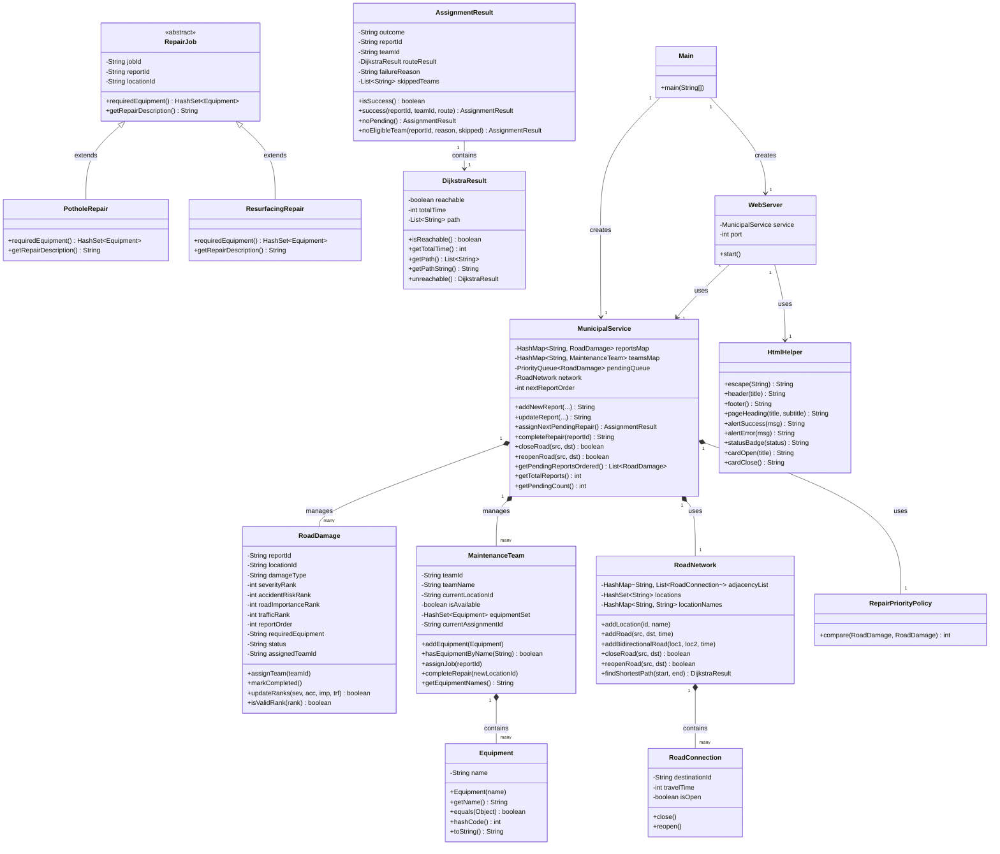

# UML DIAGRAM — Smart Municipal Road Maintenance

## Class Diagram (Mermaid)

## Relationships Summary

| Relationship | Type | Description |
|---|---|---|
| `PotholeRepair` → `RepairJob` | Inheritance | PotholeRepair IS-A RepairJob |
| `ResurfacingRepair` → `RepairJob` | Inheritance | ResurfacingRepair IS-A RepairJob |
| `MaintenanceTeam` → `Equipment` | Composition | A team HAS-A set of equipment |
| `MunicipalService` → `RoadDamage` | Aggregation | Service manages many damage reports |
| `MunicipalService` → `MaintenanceTeam` | Aggregation | Service manages 3 teams |
| `MunicipalService` → `RoadNetwork` | Aggregation | Service uses the road graph |
| `WebServer` → `MunicipalService` | Dependency | Server calls service methods |
| `RoadNetwork` → `RoadConnection` | Composition | Network contains road edges |
